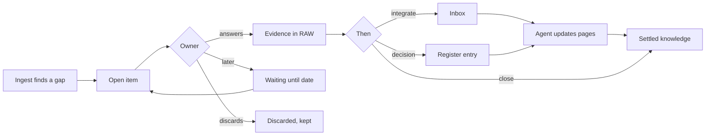
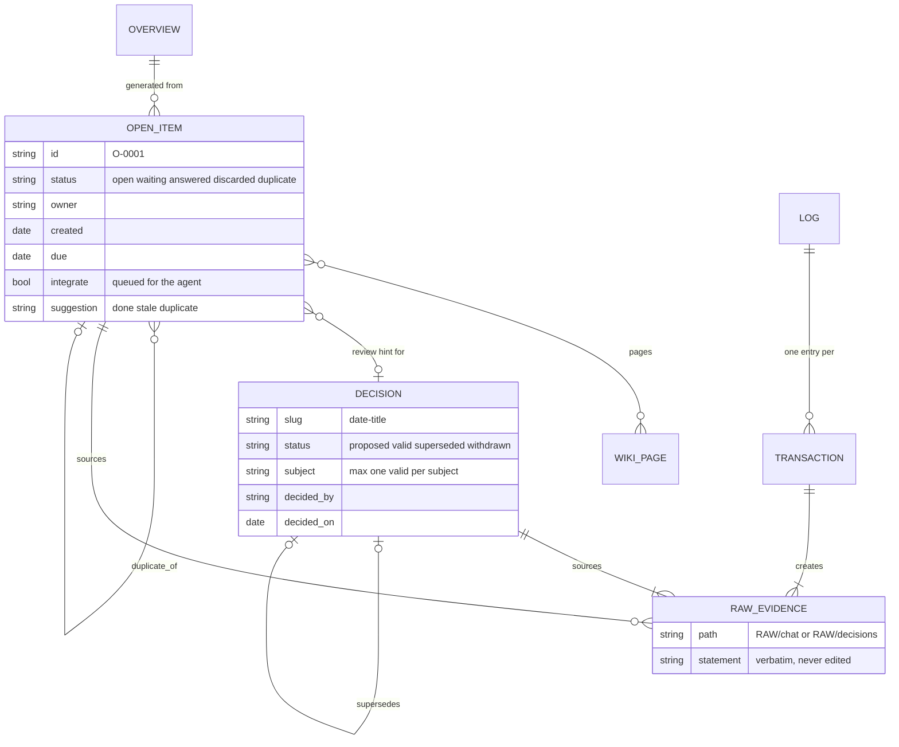
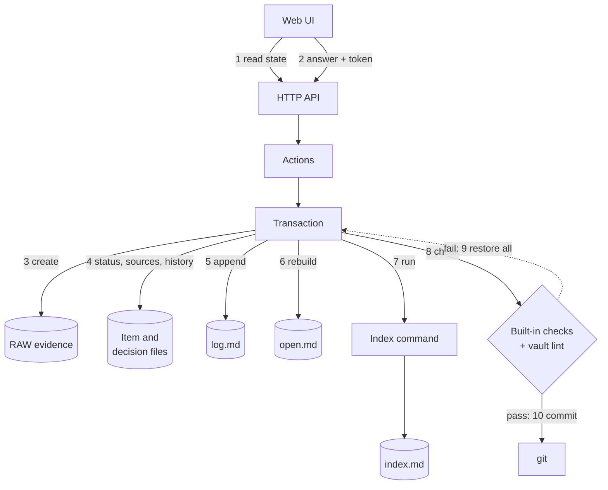
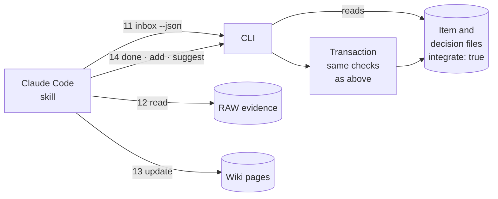
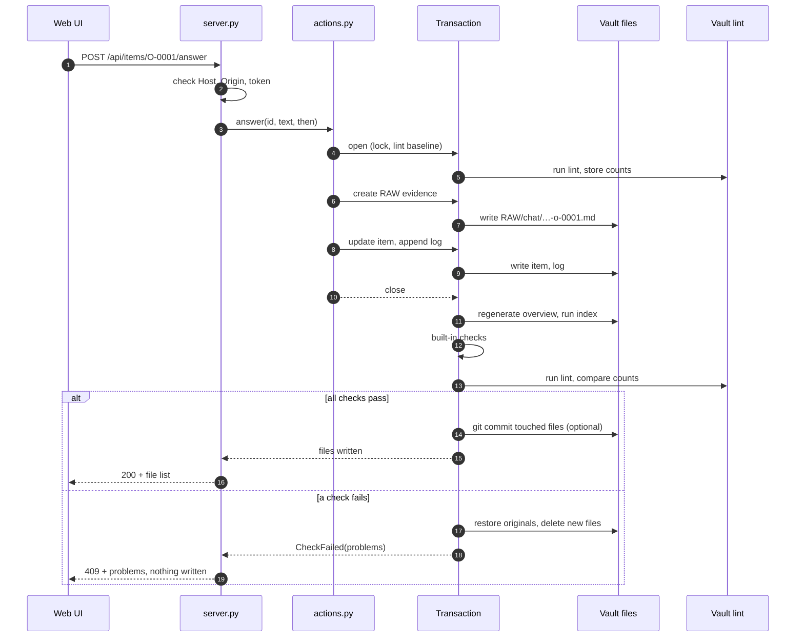
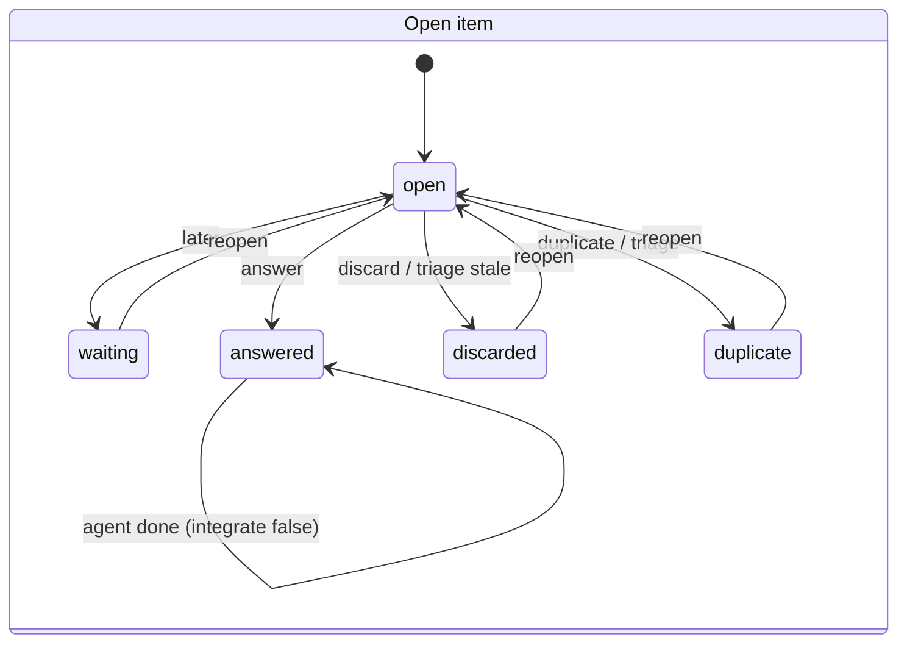
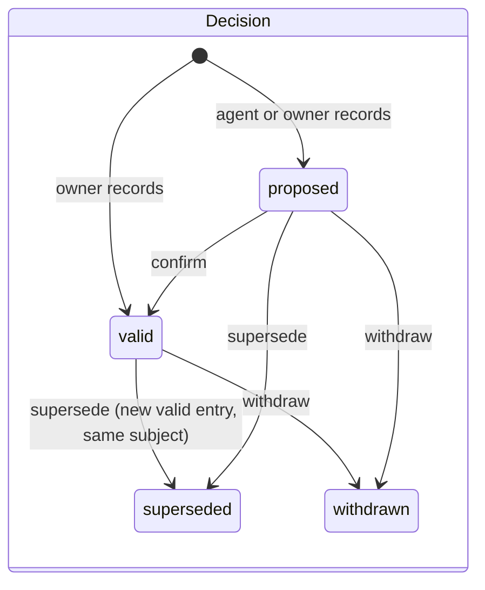

# Vault Cockpit

A local cockpit for the **open questions** and **decisions** of an LLM-maintained
wiki ([Karpathy's LLM wiki pattern](https://gist.github.com/karpathy/442a6bf555914893e9891c11519de94f):
immutable `RAW/` sources, a `Wiki/` the model maintains, a schema file that tells it how).

The model writes. The human decides. The cockpit is the human's side of that contract.

```bash
git clone https://github.com/rammc/vault-cockpit && cd vault-cockpit
PYTHONPATH=src python3 -m vault_cockpit --vault examples/demo-vault serve
```

The demo vault is fictional. `git checkout examples/` resets it.

This README follows the structure of a TOGAF architecture description:
vision, principles, the four architecture domains (business, data,
application, technology), building blocks, then gaps, risks and governance.

**Contents**

- [Quick start](#quick-start) · [Installation prompt for Claude](#installation-prompt-for-claude)
- [1. Architecture vision](#1-architecture-vision)
- [2. Architecture principles](#2-architecture-principles)
- [3. Business architecture](#3-business-architecture)
- [4. Data architecture](#4-data-architecture)
- [5. Application architecture](#5-application-architecture)
- [6. Technology architecture](#6-technology-architecture)
- [7. Building blocks](#7-building-blocks)
- [8. Requirements and constraints](#8-requirements-and-constraints)
- [9. Gaps and roadmap](#9-gaps-and-roadmap)
- [10. Risks](#10-risks)
- [11. Architecture governance](#11-architecture-governance)
- [Reference](#reference)

---

## Quick start

```bash
pipx install git+https://github.com/rammc/vault-cockpit
# or without installing:
uvx --from git+https://github.com/rammc/vault-cockpit vault-cockpit --vault ~/my-vault serve
```

1. Add a `cockpit.json` to the vault root ([schema](spec/cockpit.schema.json),
   [German example](examples/german.cockpit.json)).
2. `vault-cockpit --vault ~/my-vault migrate` previews how the hand-kept
   overview page splits into item files. Nothing is written.
3. `vault-cockpit --vault ~/my-vault migrate --write`, then `serve`.
4. Copy `skill/vault-cockpit/` into `~/.claude/skills/` so Claude Code can
   work through the inbox.

### Installation prompt for Claude

Instead of the steps above, you can let Claude Code set the cockpit up for
your vault. Open Claude Code in the vault root and paste:

````text
Set up Vault Cockpit (https://github.com/rammc/vault-cockpit) for the vault in
the current directory. Work in this order and stop where I need to confirm.

1. Prerequisites: check python3 (3.9 or newer), git, and pipx or uv. Install
   the tool with `pipx install git+https://github.com/rammc/vault-cockpit`
   (or use uvx). Clone the repo to a temporary directory so you can read
   spec/FORMAT.md, spec/cockpit.schema.json, examples/ and skill/.

2. Read my vault before writing anything: the schema file (CLAUDE.md or
   similar), the folder layout, where open questions are kept today, whether
   there is a decision register, the language and the words used for status
   values and fields, and any lint or index scripts. Summarise what you found.

3. Draft cockpit.json for the vault root, mapping my paths, status words and
   field names (see examples/german.cockpit.json for a German mapping).
   Only configure commands.lint and commands.index if those scripts exist.
   Set git.commit to true only if the vault is a git repository. Show me the
   file and wait for my OK.

4. Run `vault-cockpit migrate` (dry run) and show me how my current overview
   page would split into item files. Run `migrate --write` only after I agree.

5. Copy skill/vault-cockpit/ from the clone into ~/.claude/skills/.

6. Propose a short section for my vault schema that says: open questions are
   item files created with `vault-cockpit add`, the overview page is
   generated and never edited by hand, answers and decisions are recorded
   verbatim in RAW before the wiki changes, and only I change a decision's
   status. Show the text and add it only after I agree.

7. Start `vault-cockpit serve` and tell me the URL.

Rules: never change or delete existing files under RAW/. Do not commit or
push anything I have not seen. If my vault does not fit the format, say
where it differs instead of reshaping it on your own.
````

---

## 1. Architecture vision

### Problem

An LLM wiki is good at remembering. It is weak at deciding. Two symptoms show
up after a few weeks of use:

| Symptom | Cause | Effect |
|---|---|---|
| The open-questions page grows to hundreds of lines | Every ingest appends, nobody closes | Real questions drown, stale ones never leave |
| Decisions blur into the model's last rewrite | A rewrite is the model's reading, not a commitment someone made | Settled questions get reopened |

### Target state

- Every open question is a file with an owner, a status and a history.
- Every human answer is stored verbatim as evidence before the wiki changes.
- Every decision lives in a sealed register. Only a human changes its status.
- The agent proposes (triage, review hints, drafts). The human confirms in one place.
- Every change is all or nothing, checked by the vault's own lint.

### Stakeholders and concerns

| Stakeholder | Concern | Addressed by |
|---|---|---|
| Vault owner (human) | Answer and decide fast, without editing markdown | Web cockpit, triage in batches |
| Agent (Claude Code) | Know what to work in, never overstep | Inbox, `add`/`suggest`/`done` CLI, skill |
| Future reader | Trace why something is so | RAW evidence, history, log, register links |
| Vault schema (e.g. `CLAUDE.md`) | Rules hold regardless of who writes | Transaction checks, configurable lint |

### Scope

In scope: open items, the decision register, the generated overview, evidence,
log. Out of scope: ingest, search, wiki page authoring. Those stay with the agent.

---

## 2. Architecture principles

| # | Principle | Rationale | Implication |
|---|---|---|---|
| P1 | **Evidence first** | A wiki sentence is only as good as its source | Human statements go to a new `RAW/` file before any wiki write |
| P2 | **RAW is immutable** | Sources must not drift | The transaction refuses to modify existing RAW files |
| P3 | **Humans decide validity** | An agent's rewrite is not a decision | Only cockpit actions set `valid`, `superseded`, `withdrawn`, or close items |
| P4 | **Nothing is deleted** | History explains the present | Closed items stay; superseded decisions link to their successor |
| P5 | **All or nothing** | A half-written change is worse than none | One transaction per action, rollback on any failed check |
| P6 | **Generated, not edited** | Two writers on one page diverge | The overview page is rebuilt from item files on every change |
| P7 | **Files over database** | The vault must stay readable in any editor | Markdown plus frontmatter, documented in [`spec/`](spec/FORMAT.md) |
| P8 | **Configuration over code** | Every vault has its own vocabulary | Paths, status values and field names live in `cockpit.json` |
| P9 | **Local only** | Vault content is private | Binds to `127.0.0.1`, no external calls, no dependencies |

---

## 3. Business architecture

### Actors and roles

| Actor | Role | Channel |
|---|---|---|
| Owner | Answers, decides, triages | Web cockpit |
| Agent | Ingests, records questions, proposes, works answers in | CLI, skill |
| Obsidian (or any editor) | Reads the vault | Files, `obsidian://` links from the cockpit |
| Git | Undo and audit trail | One commit per action (optional) |

### Business capabilities

| Capability | Owner | Agent |
|---|---|---|
| Capture open question | ✓ (cockpit) | ✓ (`add` during ingest) |
| Answer open question | ✓ | |
| Work answer into wiki | | ✓ (inbox, `done`) |
| Propose closing (done, stale, duplicate) | | ✓ (`suggest`) |
| Close items | ✓ (triage, discard) | |
| Record decision | ✓ | drafts sections only |
| Change decision status | ✓ | |
| Flag decision for review | | ✓ (`add --decision`) |

### Value stream: from question to settled knowledge



---

## 4. Data architecture

### Data entities



| Entity | Location (default) | Master | Written by |
|---|---|---|---|
| Open item | `Wiki/open/O-0001.md` | Item file | Cockpit, agent via CLI |
| Decision | `Wiki/<domain>/decisions/<date>-<slug>.md` | Decision file | Cockpit (status), agent (draft sections) |
| RAW evidence | `RAW/chat/`, `RAW/decisions/` | RAW file | Cockpit, create only |
| Overview | `Wiki/open.md` | Derived | Generator only |
| Log | `Wiki/log.md` | Append only | Every transaction |
| Index | `Wiki/index.md` | Derived | The vault's own index command |

Formats are specified in [`spec/FORMAT.md`](spec/FORMAT.md) with JSON schemas
for [items](spec/open-item.schema.json), [decisions](spec/decision.schema.json)
and [configuration](spec/cockpit.schema.json).

### Data flow

Two loops share the same files. The owner's loop writes evidence and status
through the cockpit. The agent's loop reads that evidence and updates the wiki.

**Owner loop: one answer, one transaction**



**Agent loop: from inbox to settled knowledge**



| Step | What happens | Principle |
|---|---|---|
| 1 | The UI loads items, decisions and review hints as one JSON state | |
| 2 | The answer is posted with the per-session token | P9 |
| 3 | The verbatim answer becomes a new RAW file | P1, P2 |
| 4 | The item gets status, evidence link and a history line. For decisions: status and links | P3, P4 |
| 5 | One log entry per transaction | |
| 6 | The overview page is regenerated from all item files | P6 |
| 7 | The vault's index command runs. Files it changes join the transaction | |
| 8 | Built-in checks on touched pages, then the vault lint | P5 |
| 9 | Any failure restores every file and removes new ones | P5 |
| 10 | Optional commit with exactly the touched files, never a push | |
| 11–14 | The agent reads its inbox, reads the evidence, updates the pages, reports back | P3 |

### Transaction sequence



### Data lifecycles





---

## 5. Application architecture

### Components

| Component | File | Responsibility |
|---|---|---|
| Web UI | `web/index.html` | Single page, vanilla JS, no build step. Views: Open, item, register, decision, triage, inbox, new. German and English |
| HTTP API | `server.py` | `GET /api/state`, `POST /api/...` for every action. Host, Origin and token checks |
| CLI | `cli.py` | `serve`, `migrate`, `generate`, `list`, `add`, `inbox`, `done`, `suggest` |
| Actions | `actions.py` | Business logic of every change, one transaction each |
| Transaction | `txn.py` | Lock, RAW guard, rollback, generators, checks, lint, git |
| Reader | `store.py` | Parses items and decisions, attaches review hints |
| Frontmatter | `fm.py` | Reads a YAML subset, edits single keys in place without reflowing the header |
| Overview | `generate.py` | Builds `open.md`: review hints, by domain, waiting, inbox, recently closed, archive |
| Migration | `migrate.py` | Splits a hand-kept overview into item files, with triage suggestions |
| Configuration | `config.py` | Defaults merged with `cockpit.json`, canonical names to vault names |
| Vault texts | `texts.py` | Headings, history lines and RAW templates in the vault's language |
| Skill | `skill/vault-cockpit/SKILL.md` | Instructions for Claude Code |

### Interfaces

| Interface | Consumer | Contract |
|---|---|---|
| `GET /api/state` | Web UI | `{config, today, items[], decisions[]}` |
| `POST /api/items` | Web UI | create item |
| `POST /api/items/{id}/{answer,snooze,reopen,discard,duplicate,owner}` | Web UI | item actions |
| `POST /api/triage` | Web UI | `{verdicts: [{id, verdict, other?}]}` |
| `POST /api/decisions` | Web UI | create decision |
| `POST /api/decisions/{slug}/{confirm,keep,supersede,withdraw}` | Web UI | review actions |
| `vault-cockpit inbox --json` | Agent | entries queued for integration |
| `vault-cockpit add / suggest / done` | Agent | capture, propose, report back |
| `commands.lint`, `commands.index` | Cockpit | external vault tools, run in the vault root |

Errors: `400` invalid input, `404` unknown item or decision, `409` checks
failed (nothing written), `403` wrong host, origin or token.

---

## 6. Technology architecture

| Concern | Choice | Why |
|---|---|---|
| Runtime | Python 3.9+ standard library | Runs on a stock macOS Python, nothing to install |
| Server | `http.server.ThreadingHTTPServer` on `127.0.0.1` | Local tool, no framework needed |
| Front end | One HTML file, inline CSS and JS | No build, no CDN, works offline |
| Storage | Markdown files with YAML frontmatter | Readable in Obsidian, diffable in git |
| Concurrency | One lock per vault across processes (thread lock plus `flock` on a file in the temp dir); git commit retries while another git process holds the index and unstages on failure | Server and CLI run side by side (owner answers while the agent integrates) |
| Packaging | `pyproject.toml`, `pipx` / `uvx` | One command install |
| CI | GitHub Actions, Python 3.9 and 3.12 | Tests plus an installed smoke run |

### Security

| Threat | Control |
|---|---|
| Other machines on the network | Binds to `127.0.0.1` only |
| Other websites posting to the server (CSRF) | Per-session token in a custom header, Origin check |
| DNS rebinding | `Host` header must be `127.0.0.1:<port>` or `localhost:<port>` |
| Path traversal via ids | Ids and slugs validated by pattern before any file access |
| Injected markup from vault content | All content escaped before rendering, strict CSP |
| Overwriting sources | Transaction refuses to modify existing RAW files |

---

## 7. Building blocks

TOGAF separates what is needed (architecture building blocks, ABB) from how it
is built (solution building blocks, SBB).

| Architecture building block | Solution building block |
|---|---|
| Item store | One markdown file per item, `store.py` |
| Decision register | Decision pages with sealed status, `store.py`, built-in subject check |
| Evidence store | `RAW/` create-only files, `actions.raw_answer` / `raw_decision` |
| Change control | `txn.Transaction` with rollback |
| Quality gate | Built-in checks plus the vault's lint (`exit` or `no-regression` mode) |
| Derived views | `generate.py` (overview), the vault's index command |
| Human interface | Web UI |
| Agent interface | CLI plus skill |
| Audit trail | Item history, `log.md`, optional git commit per action |
| Vocabulary mapping | `cockpit.json`, `config.py`, `texts.py` |

---

## 8. Requirements and constraints

| Type | Statement |
|---|---|
| Functional | Capture, answer, defer, discard, deduplicate and assign open items |
| Functional | Record, confirm, keep, supersede and withdraw decisions; show review hints |
| Functional | Batch triage of agent suggestions; inbox for the agent |
| Functional | One-off migration from a hand-kept overview page |
| Quality | No partial writes; every change passes the vault's own lint |
| Quality | Every vault file stays readable and editable without the cockpit |
| Constraint | No third-party dependencies, Python 3.9 |
| Constraint | Never push, never call external services |
| Constraint | Existing frontmatter is edited key by key, never reformatted |

### Checks in detail

`commands.lint` runs the vault's lint after every change.

- `exit` mode: a non-zero exit code fails the change.
- `no-regression` mode: every `Label: N` line of the output is compared with
  the state before the change. If a count rises, the change fails.
  `lint_ignore` lists counts that may rise, such as the page count.

Built-in checks always run on the touched pages: frontmatter, required fields,
links, RAW sources, and at most one valid decision per subject.

---

## 9. Gaps and roadmap

| From (baseline) | To (target) | Gap | Status |
|---|---|---|---|
| One hand-kept overview page | One file per item, generated overview | Migration with suggestions | Done (`migrate`) |
| Answers given in chat | Answers in the cockpit, evidence first | Answer flow, RAW templates | Done |
| Decisions edited by the agent | Status set by the owner only | Review actions, register view | Done |
| Agent edits overview by hand | Agent uses `add` / `suggest` / `done` | Skill | Done |
| Rules checked after the fact | Rules enforced while writing | MCP server exposing the same actions to the agent | Planned |
| Single owner | Several owners | Owner list exists; per-owner views and notifications | Open |
| Local browser | Mobile capture | Read-only export or a small companion | Open |

---

## 10. Risks

| Risk | Likelihood | Impact | Mitigation |
|---|---|---|---|
| Agent edits item files directly and bypasses checks | Medium | Medium | Skill forbids it; the vault lint still runs on the next action; git history |
| Two writers at once (cockpit and an editor) | Low | Medium | Writes are small and atomic per file; git shows conflicts |
| Migration misreads an unusual overview layout | Medium | Low | Dry run first; nothing is closed automatically |
| Lint output format changes | Low | Medium | `no-regression` only compares `Label: N` lines; `exit` mode as fallback |
| Overview edited by hand | Medium | Low | Header says "generated"; the next action overwrites it |

---

## 11. Architecture governance

- **Decisions about this tool** follow its own rules. A change to the vault
  schema that the cockpit relies on (for example, introducing item files) is
  recorded in the vault's decision register first, with the owner's words in RAW.
- **Format changes** bump the version in [`spec/FORMAT.md`](spec/FORMAT.md) and
  the JSON schemas, and ship with a migration note.
- **Compliance check** for a vault: `migrate` (dry run), then the built-in
  checks and the vault lint on every write.
- **Tests** cover every action, rollback in both lint modes, the RAW guard,
  git commits, a German-mapped vault and the HTTP layer:
  `python3 -m unittest discover -s tests`.

---

## Reference

### CLI

```
vault-cockpit [--vault PATH] serve [--port 8765] [--no-browser]
vault-cockpit [--vault PATH] migrate [--write] [--json]
vault-cockpit [--vault PATH] generate
vault-cockpit [--vault PATH] list [--all] [--json]
vault-cockpit [--vault PATH] add TITLE [--text ..] [--page SLUG]... [--decision SLUG] [--origin ..]
vault-cockpit [--vault PATH] inbox [--json]
vault-cockpit [--vault PATH] done ID_OR_SLUG
vault-cockpit [--vault PATH] suggest ID {done,stale,duplicate,keep} REASON
```

`--vault` defaults to `$VAULT_COCKPIT_VAULT`, then the current directory.

### Configuration

All keys with defaults: [`spec/cockpit.schema.json`](spec/cockpit.schema.json).
The most important ones:

| Key | Purpose |
|---|---|
| `paths.*` | Where items, overview, log, decisions and RAW evidence live |
| `item_status`, `decision_status` | The vault's words for each status |
| `item_fields`, `decision_fields` | The vault's field names |
| `vault_language`, `ui_language` | `en` or `de` |
| `unconfirmed_trigger_marker` | Text that marks agent-proposed review triggers |
| `commands.lint`, `lint_mode`, `lint_ignore`, `commands.index` | Vault tools in the transaction |
| `git.commit` | One commit per action |
| `obsidian_vault` | Open wiki links in Obsidian |

### Development

```bash
python3 -m unittest discover -s tests
```

## License

MIT
